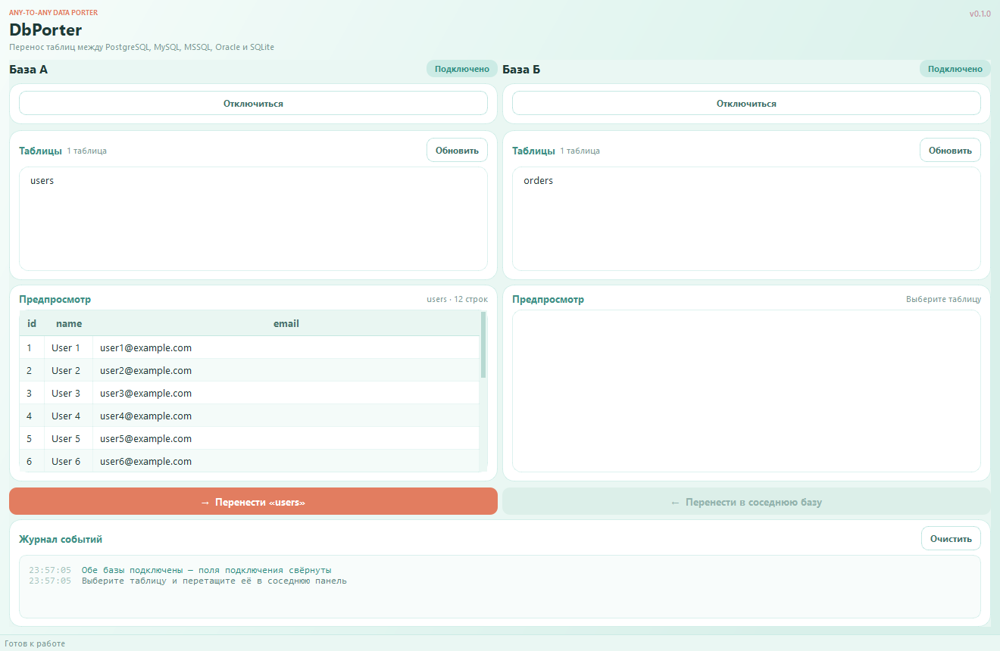

# DbPorter

**DbPorter** — десктопный инструмент для переноса таблиц между разными СУБД через SQLAlchemy
и pandas. PostgreSQL, MySQL/MariaDB, MS SQL, SQLite и Oracle — в любом направлении,
без ручных скриптов под каждую пару баз.

<p align="center">
  <b>База А ⇄ База Б</b><br>
  подключились · выбрали таблицу · перетащили · готово
</p>



---

##  Что умеет

- **Единое ядро на SQLAlchemy 2.0** — PostgreSQL (`psycopg`), MySQL/MariaDB (`pymysql`),
  SQLite (встроенный), MS SQL (`pyodbc`), Oracle (`oracledb`, опционально).
- **Pydantic-валидация** параметров подключения и YAML-конфигов.
- **Инспекция схемы**: список таблиц, колонки, типы, первичные ключи.
- **Порционная передача** — чтение чанками, без загрузки всей таблицы в RAM.
- **Транзакционная запись** — при ошибке на середине целевая таблица откатывается.
- **Сохранение схемы** — типы, `nullable` и первичный ключ переносятся по возможности;
  индексы копируются best-effort.
- **GUI на PySide6**: тёмная тема, две равноправные панели, Drag & Drop,
  предпросмотр первых 100 строк и журнал событий.
- **Фоновые задачи** — подключение, превью и перенос не блокируют интерфейс.
- **CLI** — `dbporter copy` и `dbporter tables` для автоматизации.

---

## Быстрый старт

Нужен Python 3.10+ и pip.

### Windows (PowerShell)

```powershell
python -m venv venv
.\venv\Scripts\Activate.ps1
pip install -e ".[gui,dev]"
dbporter-gui
```

### Linux / macOS

```bash
python3 -m venv .venv
source .venv/bin/activate
pip install -e ".[gui,dev]"
dbporter-gui
```

Для Oracle дополнительно:

```bash
pip install -e ".[gui,oracle]"
```

### Запуск без установки

```bash
python -m dbporter.gui.app
```

---

## Как пользоваться GUI

1. В левой панели выберите тип БД и заполните параметры подключения.
2. Нажмите **«Подключиться»** — появится список таблиц.
3. Повторите для правой панели.
4. Кликните по таблице, чтобы увидеть первые 100 строк.
5. Перетащите таблицу в соседнюю панель **или** нажмите
   **«Перенести «таблица»»**.
6. Следите за прогрессом и результатом в журнале событий внизу.

Панели равноправны: переносить можно как слева направо, так и справа налево.
Повторный перенос с режимом `replace` пересоздаёт целевую таблицу.

---

## CLI

```bash
# Показать таблицы источника
dbporter tables --config config.yaml

# Перенести все таблицы из конфига
dbporter copy --config config.yaml

# Только выбранные таблицы, с размером чанка
dbporter copy --config config.yaml --table users --table orders --chunk-size 10000

# Добавить данные в существующую таблицу
dbporter copy --config config.yaml --table users --if-exists append
```

Коды возврата: `0` — успех, `1` — ошибка хотя бы одной таблицы, `130` — прерывание.

---

## Конфиг

```yaml
source:
  db_type: postgresql
  host: localhost
  port: 5432
  database: demo
  username: postgres
  password: secret

target:
  db_type: sqlite
  database: ./target.db

tables: [users, orders]   # пусто = все таблицы источника
chunk_size: 50000
workdir: ./tmp            # зарезервировано под промежуточные файлы
```

Поддерживаемые `db_type`: `postgresql`, `postgres`, `mysql`, `mariadb`,
`sqlite`, `mssql`, `oracle`. Для экзотических случаев можно передать готовый
SQLAlchemy URL через `url_override`.

### MS SQL: Windows-аутентификация и именованный экземпляр

Оставьте `username` и `password` пустыми — тогда используется Windows-аутентификация
(`trusted_connection=yes`). Именованный экземпляр указывается в `host` целиком,
порт при этом не нужен (он определяется через SQL Browser):

```yaml
source:
  db_type: mssql
  host: 'localhost\SQLEXPRESS01'
  database: dbporter_test
```

В GUI поля «Пользователь»/«Пароль» можно не заполнять, а «Порт» — оставить пустым.

---

## Структура проекта

```text
Dbporter/
├── pyproject.toml
├── src/dbporter/
│   ├── core/           # SQLAlchemy engine и инспекция схемы
│   ├── extractors/     # БД -> pandas (чанками)
│   ├── loaders/        # pandas -> БД (транзакционно)
│   ├── formats/        # CSV/JSON утилиты (импорт/экспорт)
│   ├── gui/            # PySide6-интерфейс
│   ├── pipeline.py     # оркестратор переноса
│   ├── config.py       # Pydantic-модели и YAML
│   ├── cli.py          # командная строка
│   └── exceptions.py   # иерархия ошибок
├── tests/
└── README.md
```

---

## 🧪 Тесты

```bash
pytest
ruff check src tests
```

Покрыты конфиг, подключение, схема, форматы, а также перенос данных:
кавычки/зарезервированные слова в именах, пустые таблицы, откат при ошибке,
защита от переноса таблицы «в себя».

---

## Ограничения

- Типы данных конвертируются через generic-типы SQLAlchemy; экзотические типы
  конкретного диалекта могут не скомпилироваться в приёмнике — тогда используется
  вывод типов pandas.
- Переносятся данные, `nullable`, PK и (best-effort) индексы. Внешние ключи,
  `CHECK`-ограничения, серверные default-значения и комментарии пока не копируются.
- В MySQL/MariaDB и Oracle DDL коммитится неявно, поэтому атомарность `DROP/CREATE`
  гарантируется не полностью. В SQLite/PostgreSQL/MSSQL транзакция включает и DDL.
- `sqlite:///:memory:` у каждого Engine — отдельная база; для GUI используйте файл.
- Имена таблиц с точкой внутри требуют явной схемы; в GUI выбор схемы пока не вынесен.
- Oracle требует установленного драйвера `oracledb` (extra `oracle`).
- Для MS SQL ODBC-драйвер подбирается автоматически из установленных; свой можно
  задать через `query: {driver: ...}` или `url_override`. Пустые логин/пароль
  означают Windows-аутентификацию, а порт для именованного экземпляра игнорируется.

---


## Лицензия

MIT.
